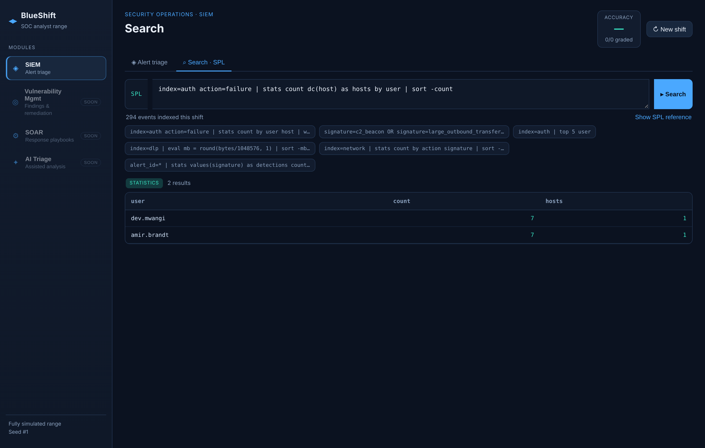

# BlueShift

**A fully simulated SOC analyst training range.** Triage a shift of SIEM alerts,
read the raw events, map each to MITRE ATT&CK, and decide the disposition —
then get graded against the alert's hidden ground truth. Everything is
deterministic and offline: no backend, no API keys, no live scanning.

> BlueShift is a *learning simulator*. It does not connect to, scan, or attack
> any real system. The environment, assets, logs and alerts are synthetic and
> generated from a seed.



## Why

Real SOC work is mostly triage under noise: most alerts are false positives or
benign, and the skill is telling the real threat from the rest quickly and
correctly. BlueShift generates a realistic, reproducible shift of alerts — brute
force, C2 beacons, phishing, privilege escalation, data exfiltration, MFA
fatigue, impossible travel, and more — each backed by raw log lines and a hidden
verdict. You triage; it scores your accuracy.

It also ships a **Splunk-like SPL search** over the shift's event index, so you
can hunt and pivot the way you would in a real SIEM.

## SPL search

The **Search** tab runs a pipe-based query language over the indexed events:

```spl
index=auth action=failure | stats count dc(host) as hosts by user | sort -count
signature=c2_beacon OR signature=large_outbound_transfer | table time host dest_ip bytes
index=dlp | eval mb = round(bytes/1048576, 1) | sort -mb | table host mb dest_ip
index=auth | top 5 user
```

Supported commands: an implicit `search` (field=value, `!=`, `<` `>` `<=` `>=`,
wildcards `*`, `AND`/`OR`/`NOT`, parentheses, quoted phrases, bare terms) then a
pipeline of `stats`, `where`, `eval`, `table`/`fields`, `rename`, `sort`,
`head`/`tail`, `top`/`rare`, `dedup`. Functions include `count`, `dc`, `sum`,
`avg`, `min`, `max`, `values`, `list`, `round`, `lower`, `upper`, `len`, `if`,
`coalesce`, `like`, `match`, `isnull`, `isnotnull`. Press **Ctrl/⌘+Enter** to run.
The whole engine is a pure, separately-tested module (`src/spl.js`).

## Run it

No build step is required to *use* it — just open the built page:

```
# open dist/index.html in any modern browser
```

To build from source and run the tests:

```
node build.js                 # bundle src/ into dist/index.html (self-contained)
npm test                      # model unit tests (deterministic engine)
npm run test:ui               # build + Playwright UI test (needs: npm i playwright && npx playwright install)
```

## How it works

BlueShift follows a **pure-logic + thin-UI** design, bundled into a single
self-contained HTML file with zero runtime dependencies:

| File | Responsibility |
|------|----------------|
| `src/rng.js` | Seeded PRNG — the whole world is a function of one seed (reproducible). |
| `src/catalog.js` | Static building blocks: asset pools and the detection **archetypes** (each with a ground-truth verdict distribution and MITRE mapping). |
| `src/model.js` | `generateEnvironment(seed)` → assets + correlated alerts + a structured **event index**; plus query, triage and scoring helpers. Pure and fully unit-tested. |
| `src/spl.js` | The SPL search engine: an implicit `search` plus a pipeline of commands (`stats`, `where`, `eval`, `table`, `sort`, `top`, …). Pure and separately tested. |
| `src/ui.js` | The platform shell + SIEM console. A thin presentation layer over the model. |
| `src/styles.css` | The dark SOC theme. |
| `build.js` | Inlines the tested modules + UI + styles into `dist/index.html` via a tiny CommonJS shim — so the shipped page is byte-for-byte a function of source (no drift). |

Because the model is pure and deterministic, the same seed always yields the
same shift, which keeps scenarios fair and the test suite stable.

## Roadmap

The app is a **platform shell** — the SIEM module is the first of several. The
rail already shows what's next:

- **SIEM** — alert triage console *(shipped)*
- **Vulnerability Management** — asset findings, CVSS, remediation tracking
- **SOAR** — response playbooks (isolate host → block source → open incident)
- **AI-assisted triage** — explain an alert, recommend next steps, draft the write-up

All planned as the same fully-simulated, deterministic, testable approach.

## License

MIT — see [LICENSE](LICENSE).
